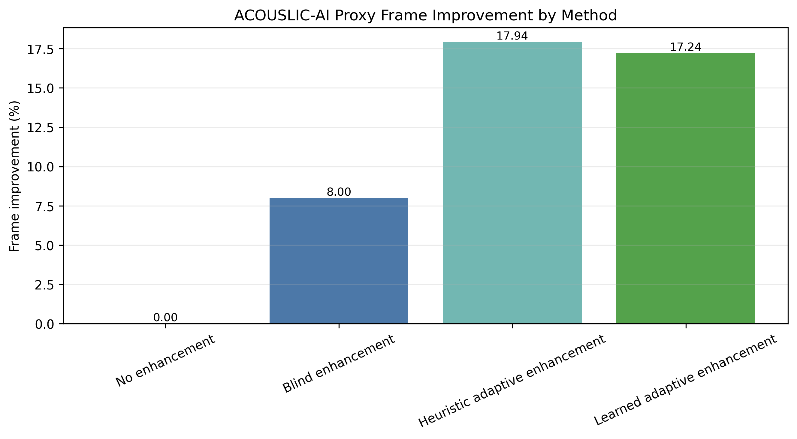
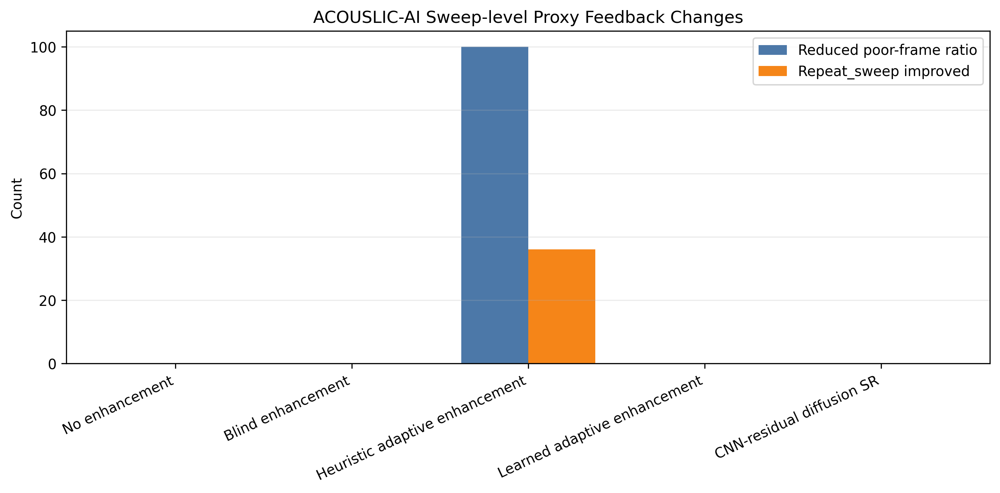
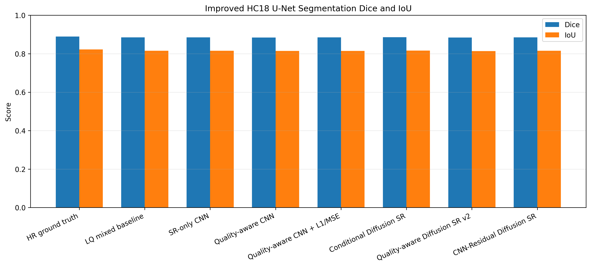
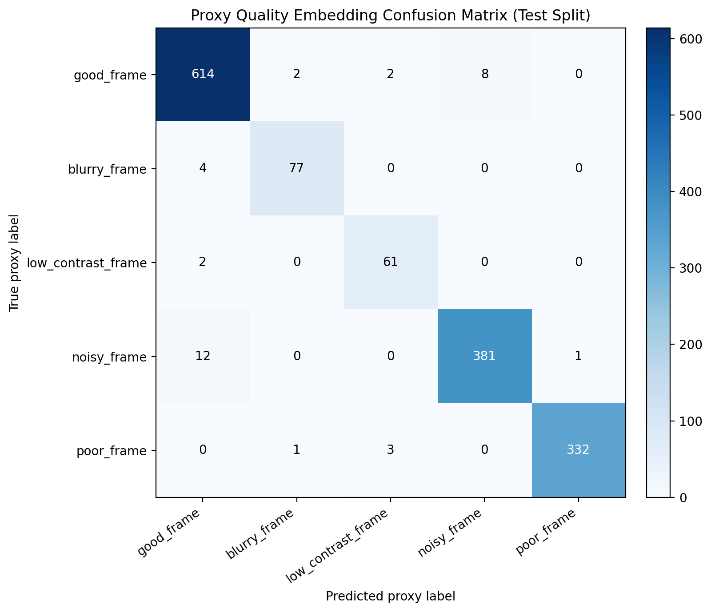

# Proxy Acquisition-Aware Fetal Ultrasound Enhancement with Adaptive Feedback and Diffusion-Based Boundary Refinement

## Abstract

Novice-acquired fetal ultrasound can suffer from blur, noise, low contrast, unstable sweep motion, and incomplete acquisition, especially in low-resource settings where experienced sonographers may not always be available. Standard super-resolution methods improve image appearance, but they do not explicitly estimate acquisition quality, decide which enhancement action is appropriate, or reassess whether sweep-level feedback should change after enhancement. This report presents a proxy acquisition-aware fetal ultrasound enhancement framework that estimates proxy image and sweep quality, learns a quality embedding, selects adaptive enhancement actions, performs CNN-based and DMUISR-guided / diffusion-inspired restoration, and updates feedback decisions through offline reassessment. The framework is evaluated using HC18 for controlled super-resolution and anatomy preservation, and ACOUSLIC-AI for proxy quality estimation, adaptive enhancement, and sweep-feedback analysis. Results show that CNN models provide the strongest global reconstruction, residual diffusion improves edge preservation, adaptive enhancement improves frame quality more than blind enhancement, and feedback reassessment reduces poor-frame ratios in the analyzed sweeps. The study uses proxy acquisition-quality labels and offline feedback analysis; it does not claim expert clinical validation, real-time deployment, real probe-motion labels, or exact DMUISR reproduction.

## 1. Introduction

Fetal ultrasound quality depends strongly on acquisition conditions and operator skill. In novice blind-sweep ultrasound, image quality may degrade because of unstable probe motion, suboptimal contact, weak fetal-head visibility, motion blur, speckle noise, and poor contrast. These problems are particularly important in low-resource settings, where simplified acquisition protocols can improve access but may also produce inconsistent image quality.

Most super-resolution pipelines focus on restoring a degraded image to a sharper image. However, fetal ultrasound enhancement is not only a reconstruction problem. A useful framework should also estimate whether the input frame or sweep is poor, decide whether the image should be enhanced, denoised, preserved, or treated as needing repeat acquisition, and then reassess whether the feedback decision changed after enhancement.

This project connects enhancement with acquisition-aware feedback. It combines controlled HC18 super-resolution experiments with ACOUSLIC-AI proxy quality analysis. HC18 validates reconstruction and anatomy preservation using fetal-head masks. ACOUSLIC-AI supports offline analysis of proxy frame-quality labels, sweep-feedback labels, adaptive enhancement, and feedback reassessment.

## 2. Related Work

### 2.1 Fetal Ultrasound Super-Resolution

Fetal ultrasound super-resolution aims to improve spatial detail and reduce degradation in ultrasound frames. CNN-based models often perform well on global reconstruction metrics such as PSNR, SSIM, and MAE. In this project, CNN models are used as practical enhancement baselines and as quality-aware restoration components.

### 2.2 Diffusion-Based Ultrasound SR / DMUISR-Inspired SR

Diffusion-based super-resolution has attracted interest because iterative refinement can improve perceptual detail and boundary sharpness. This work uses DMUISR-guided / diffusion-inspired ideas rather than claiming an exact DMUISR reproduction. The diffusion branch is interpreted primarily as boundary and edge refinement, not as the best method for every reconstruction metric.

### 2.3 Fetal Ultrasound IQA

Image-quality assessment estimates whether ultrasound frames are blurred, noisy, low-contrast, or otherwise unreliable. IQA is valuable, but by itself it does not perform restoration or decide how enhancement should be adapted to the quality state.

### 2.4 Blind-Sweep Fetal Ultrasound

Blind-sweep fetal ultrasound can support acquisition by less experienced operators, but it raises sweep-level quality challenges. A sweep may contain many poor frames, excessive motion, unstable probe movement, or insufficient visibility. This project treats ACOUSLIC-AI as a source for proxy acquisition-quality and sweep-feedback analysis.

### 2.5 Probe Guidance and Novice Feedback

Probe guidance methods aim to help operators improve acquisition. The present work does not use real probe-motion or IMU labels and does not claim real-time scanner guidance. Instead, it performs offline feedback analysis using proxy image and sweep features.

### Gap

Prior work often studies super-resolution, IQA, sweep-quality analysis, and probe guidance separately. This work connects SR/diffusion enhancement with proxy acquisition-quality estimation, adaptive enhancement, and feedback reassessment in one fetal ultrasound enhancement framework.

## 3. Methodology

### 3.1 Overall Framework

The framework follows an acquisition-aware enhancement loop:

```text
Low-quality fetal ultrasound image/sweep
-> proxy acquisition-quality estimation
-> learned quality embedding
-> adaptive enhancement decision
-> CNN / residual diffusion refinement
-> quality reassessment
-> updated feedback decision
```

The design separates image restoration from acquisition feedback while allowing the two branches to inform each other.

### 3.2 HC18 Super-Resolution Branch

HC18 provides controlled fetal-head ultrasound frames and masks. The branch prepares high-resolution images, generates degraded low-quality inputs, trains CNN and diffusion-inspired enhancement models, and evaluates reconstruction using PSNR, SSIM, MAE, and edge score.

### 3.3 ACOUSLIC-AI Proxy Quality and Feedback Branch

The ACOUSLIC-AI branch extracts frames from blind-sweep ultrasound stacks and computes image and motion-derived proxy features, including blur, contrast, brightness, noise proxy, edge density, frame difference, optical-flow magnitude, and jitter. These features generate proxy acquisition-quality labels and sweep-feedback labels for offline analysis.

### 3.4 Learned Proxy-Quality Embedding

A learned proxy-quality embedding maps image and motion features to frame-level proxy quality classes such as `good_frame`, `blurry_frame`, `low_contrast_frame`, `noisy_frame`, and `poor_frame`. The learned embedding supports adaptive enhancement decisions while remaining limited by proxy labels rather than expert clinical annotations.

### 3.5 Adaptive Feedback-Aware Enhancement

Adaptive enhancement selects actions based on proxy quality state. This differs from blind enhancement, where the same restoration is applied to every frame. The heuristic and learned adaptive branches decide when to preserve, denoise, sharpen, or enhance frames according to estimated quality.

### 3.6 Feedback Reassessment Loop

After enhancement, proxy frame quality and sweep feedback are recomputed. This offline reassessment tests whether enhancement reduces poor-frame ratios or changes repeat-sweep decisions. Motion-based feedback can remain unchanged when poor quality is caused by unstable acquisition rather than image appearance alone.

### 3.7 CNN-Residual Diffusion Boundary Refinement

The CNN-residual diffusion branch uses CNN outputs as a guide and applies residual diffusion-inspired refinement. Its role is boundary and edge refinement. The results support this interpretation: residual diffusion gives the strongest edge score, while CNN models remain stronger for global reconstruction metrics.

### 3.8 Segmentation-Based Anatomy Preservation

An improved HC18-trained U-Net is used for supporting anatomy-preservation analysis. Masks are preprocessed with an ellipse-fitted filled-mask method selected by a successful overfit sanity check. Dice, IoU, boundary error, fetal area error, and equivalent diameter error are reported as supporting evidence only and should not be interpreted as expert clinical validation.

## 4. Experimental Setup

### 4.1 Dataset Summary

| Dataset | Role | Inputs | Labels / targets | Use |
|---|---|---|---|---|
| HC18 | Controlled SR and anatomy preservation | Single fetal-head ultrasound frames | HR targets and fetal-head masks | Reconstruction, anatomy preservation, segmentation support |
| ACOUSLIC-AI | Blind-sweep proxy quality and feedback | Sweep-derived fetal ultrasound frames | Proxy acquisition-quality labels and proxy feedback labels | Adaptive enhancement and offline feedback reassessment |

### 4.2 Metrics

| Metric | Purpose |
|---|---|
| PSNR | Pixel-level reconstruction fidelity |
| SSIM | Structural similarity |
| MAE | Mean absolute reconstruction error |
| Edge score | Edge and boundary preservation |
| Inside-mask MAE | Error inside fetal-head mask |
| Boundary error | Error near fetal-head boundary |
| Contrast preservation | Retention of foreground/background contrast |
| Boundary edge similarity | Fetal-head boundary edge agreement |
| Dice / IoU | U-Net segmentation overlap |
| Area error / diameter error | Fetal-head measurement proxy errors |
| Frame improvement rate | ACOUSLIC-AI proxy frame-quality improvement |
| Sweep feedback change | Offline change in proxy feedback labels |
| Accuracy / macro-F1 | Proxy-quality embedding classification |

### 4.3 Model Variants

| Variant | Quality-aware | Adaptive action | CNN restoration | Diffusion-inspired refinement | Purpose |
|---|---|---|---|---|---|
| LQ mixed baseline | No | No | No | No | Degraded input reference |
| SR-only CNN | No | No | Yes | No | CNN reconstruction baseline |
| Quality-aware CNN + L1/MSE | Yes | No | Yes | No | Quality-conditioned reconstruction |
| Conditional Diffusion SR | No | No | No | Yes | Diffusion-inspired SR baseline |
| CNN-Residual Diffusion SR | No acquisition feedback | No | Yes | Yes | Edge and boundary refinement |
| Heuristic adaptive enhancement | Proxy labels | Yes | Yes | No | Adaptive frame enhancement |
| Learned adaptive enhancement | Learned embedding | Yes | Yes | No | Learned proxy-quality action support |

### 4.4 Evaluation Protocol

HC18 models are evaluated on held-out test images using reconstruction metrics and mask-based anatomy-preservation metrics. The improved U-Net is trained on HC18 masks with ellipse-fitted filled preprocessing, threshold-tuned on validation data, and evaluated first on HR test images before restored outputs. ACOUSLIC-AI analysis uses 10,000 frames from 100 sweeps for proxy quality estimation, adaptive enhancement, learned embedding evaluation, and offline sweep-feedback reassessment.

## 5. Results and Evaluation

### Table 1. HC18 Reconstruction Comparison

| Method | PSNR | SSIM | MAE | Edge score |
|---|---:|---:|---:|---:|
| LQ Mixed Baseline | 25.3376 | 0.6733 | 0.0338 | 0.8147 |
| SR-only CNN | **30.7646** | 0.8510 | 0.0182 | 0.9082 |
| Quality-aware CNN + L1/MSE | 30.5746 | **0.8737** | **0.0174** | 0.8969 |
| Conditional Diffusion SR | 28.2914 | 0.8297 | 0.0254 | 0.9343 |
| CNN-Residual Diffusion SR | 29.8726 | 0.8686 | 0.0206 | **0.9542** |

CNN models are stronger for global reconstruction: SR-only CNN gives the best PSNR, and Quality-aware CNN + L1/MSE gives the best SSIM and MAE. CNN-Residual Diffusion SR gives the best edge score, supporting its use as a boundary-refinement component rather than the best model for all metrics.

### Table 2. Mask-Based Anatomy Preservation

| Method | Inside-mask MAE | Boundary error | Contrast preservation | Boundary edge similarity |
|---|---:|---:|---:|---:|
| LQ Mixed Baseline | 0.0688 | 0.0670 | 0.7292 | 0.8217 |
| SR-only CNN | **0.0316** | **0.0303** | **0.9727** | **0.9582** |
| Quality-aware CNN + L1/MSE | 0.0320 | 0.0305 | 0.9678 | 0.9563 |
| Conditional Diffusion SR | 0.0449 | 0.0435 | 0.9240 | 0.9320 |
| CNN-Residual Diffusion SR | 0.0363 | 0.0349 | 0.9440 | 0.9415 |

The mask-based metrics show that learned enhancement improves anatomy-region reconstruction over the degraded baseline. SR-only CNN is strongest on this set of mask-based measurements, while residual diffusion remains competitive and improves edge-oriented behavior in Table 1.

### Table 3. Segmentation-Based Anatomy Preservation

Improved U-Net summary: best validation Dice = 0.8776, validation IoU = 0.8130, HR test Dice = 0.8897.

| Method | Dice | IoU | Boundary error | Area error % | Diameter error % |
|---|---:|---:|---:|---:|---:|
| HR Image Reference | 0.8897 | 0.8225 | 9.7192 | 19.9109 | 9.4812 |
| LQ Mixed Baseline | 0.8850 | 0.8150 | 10.1920 | 20.2224 | 9.6149 |
| SR-only CNN | 0.8853 | 0.8157 | 10.4459 | 20.9446 | 9.8825 |
| Quality-aware CNN + L1/MSE | 0.8847 | 0.8148 | 10.4485 | 21.1400 | 9.9617 |
| Conditional Diffusion SR | 0.8857 | 0.8163 | 10.2369 | 20.6967 | 9.7734 |
| CNN-Residual Diffusion SR | 0.8854 | 0.8156 | 10.4032 | 20.7863 | 9.8379 |

Dice, IoU, and fetal measurement error are computed using an HC18-trained U-Net segmentation model with ellipse-fitted filled mask preprocessing and HC18 fetal-head masks. These metrics are supporting anatomy-preservation evidence, not expert clinical validation.

### Table 4. Proxy Frame-Quality Distribution

| Proxy frame-quality label | Count |
|---|---:|
| `good_frame` | 4531 |
| `noisy_frame` | 2462 |
| `poor_frame` | 2031 |
| `blurry_frame` | 507 |
| `low_contrast_frame` | 469 |
| **Total** | **10000** |

The proxy labels show that the ACOUSLIC-AI sample contains a substantial number of noisy and poor frames, making it suitable for offline adaptive enhancement and feedback reassessment experiments.

### Table 5. Sweep Feedback Distribution

| Proxy sweep-feedback label | Count |
|---|---:|
| `repeat_sweep` | 60 |
| `move_slower` | 25 |
| `keep_probe_steady` | 13 |
| `improve_visibility` | 0 / not observed in the 100-sweep summary |
| `acceptable` | 2 |
| **Total** | **100** |

Most sweeps receive `repeat_sweep` or motion-related feedback. This is important because enhancement can improve image appearance, but motion-based problems may still require acquisition changes.

### Table 6. Main Ablation Table

| Method | Frame improvement % | Interpretation |
|---|---:|---|
| Original / No Enhancement | 0.00 | Baseline reference |
| Blind Enhancement | 8.00 | Same enhancement action for all frames |
| Heuristic Adaptive Enhancement | **17.94** | Uses proxy quality labels for action selection |
| Learned Adaptive Enhancement | 17.24 | Uses learned proxy-quality embedding |

Adaptive enhancement improves more frames than blind enhancement because it uses quality-aware action selection rather than applying one fixed enhancement to every frame.

### Table 7. Feedback Reassessment Table

| Measure | Value |
|---|---:|
| Sweeps analyzed | 100 |
| Sweeps with reduced poor-frame ratio | 100 |
| Mean poor-frame-ratio reduction | 0.1794 |
| Sweeps with improved good-frame ratio | 100 |
| Repeat-sweep cases changed to acceptable or improve-visibility | 36 |
| Feedback decisions unchanged due to motion-based problems | 28 |

This supports the closed-loop design: enhancement is not only evaluated as an image-restoration step, but also reassessed for its effect on offline sweep-level feedback.

### Table 8. Learned Proxy-Quality Embedding

| Split | Frames | Accuracy | Macro-F1 |
|---|---:|---:|---:|
| Train | 7000 | 0.9820 | 0.9797 |
| Validation | 1500 | 0.9813 | 0.9779 |
| Test | 1500 | **0.9767** | **0.9688** |

The learned embedding indicates that image and motion features can represent proxy acquisition quality with high accuracy. The result remains limited by the use of proxy labels rather than expert clinical annotations.

## 6. Figures for the Main Report

| Figure | File | Status |
|---|---|---|
| Overall framework figure | `results/final_workflow_figure.png` | Not found in current results folder |
| HC18 SR/anatomy branch figure | `results/report_assets/figure_psnr_comparison.png`, `results/report_assets/figure_boundary_error.png` | Available as supporting branch figures |
| Acquisition frame improvement | `results/final_ablation_figures/acquisition_frame_improvement.png` | Available |
| Acquisition sweep feedback changes | `results/final_ablation_figures/acquisition_sweep_feedback_changes.png` | Available |
| Improved U-Net Dice/IoU comparison | `results/hc18_unet_segmentation_figures/improved_dice_iou_comparison.png` | Available |
| Frame quality distribution | `results/acouslic_ai/feedback_report/frame_quality_distribution.png` | Available |
| Sweep feedback distribution | `results/acouslic_ai/feedback_report/sweep_feedback_distribution.png` | Available |
| Proxy-quality embedding confusion matrix | `results/acouslic_ai/proxy_quality_embedding_confusion_matrix.png` | Available |

Recommended inline figure references:









## 7. Discussion

Adaptive enhancement is more effective than blind enhancement because fetal ultrasound degradation is not uniform. A noisy frame, blurry frame, low-contrast frame, and acceptable frame should not receive the same action. The heuristic adaptive branch improves 17.94% of frames compared with 8.00% for blind enhancement, while the learned adaptive branch remains close at 17.24%.

Diffusion-inspired refinement is useful for edge and boundary preservation. CNN-Residual Diffusion SR achieves the strongest edge score of 0.9542, even though CNN models remain better for PSNR, SSIM, and MAE. This supports using diffusion as a boundary refinement component rather than presenting it as the best global reconstruction model.

Feedback reassessment is important because enhancement should be evaluated in relation to acquisition quality, not only image quality. The 100-sweep ACOUSLIC-AI reassessment reduced poor-frame ratios for all analyzed sweeps and improved 36 repeat-sweep cases. At the same time, 28 feedback decisions remained unchanged due to motion-based problems, showing that image enhancement alone cannot correct all acquisition failures.

Proxy labels are useful for framework development and offline analysis, but they remain limited. They are derived from image and sweep features, not expert clinical annotations. Therefore, the results support a research prototype and hypothesis, not clinical validation.

## 8. Limitations

- Proxy labels are not expert clinical labels.
- Feedback analysis is offline only.
- The project does not use real probe-motion or IMU labels.
- Expert validation has not yet been performed.
- The system is not deployed for real-time clinical scanner use.
- The learned action policy is future work.
- Diffusion experiments are DMUISR-guided / diffusion-inspired and do not claim exact DMUISR reproduction.
- Motion-based acquisition problems cannot always be fixed by image enhancement alone.

## 9. Conclusion

This report presents a proxy acquisition-aware fetal ultrasound enhancement framework that connects fetal ultrasound restoration with acquisition-quality feedback. HC18 validates controlled reconstruction, anatomy preservation, and improved segmentation-based support analysis. ACOUSLIC-AI validates proxy quality estimation, adaptive enhancement, learned quality embedding, and offline feedback reassessment. The results show that CNN models are strongest for global reconstruction, residual diffusion is useful for edge and boundary refinement, and adaptive enhancement improves frame quality more effectively than blind enhancement. The framework should be interpreted as a conference-style research prototype requiring expert validation before clinical use.

