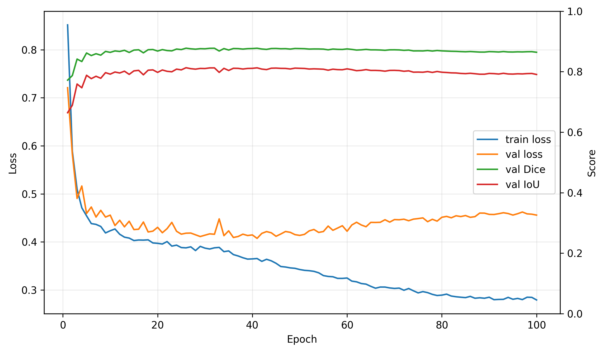
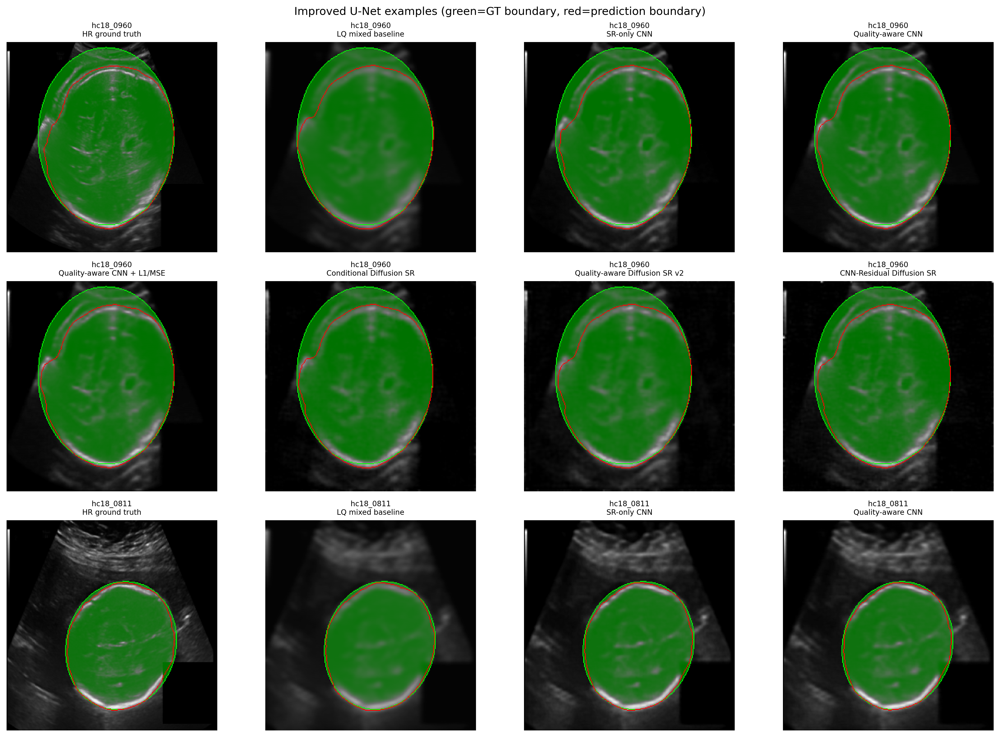
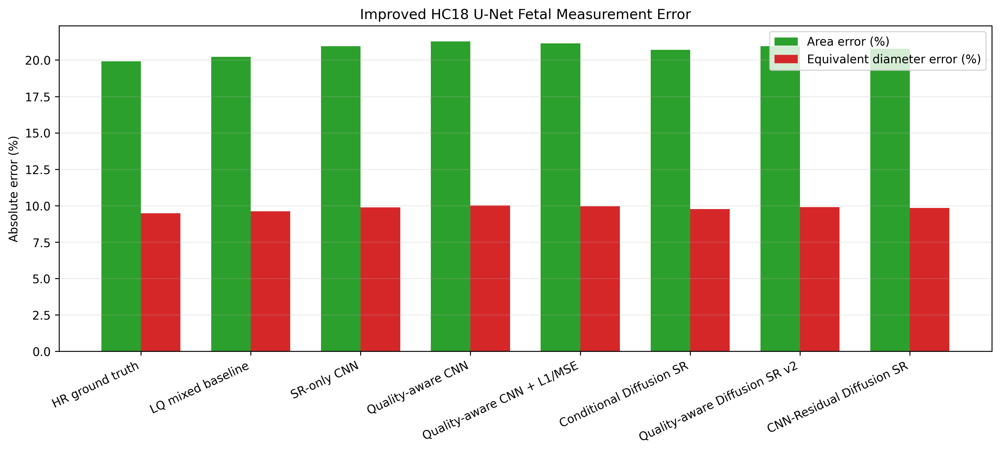
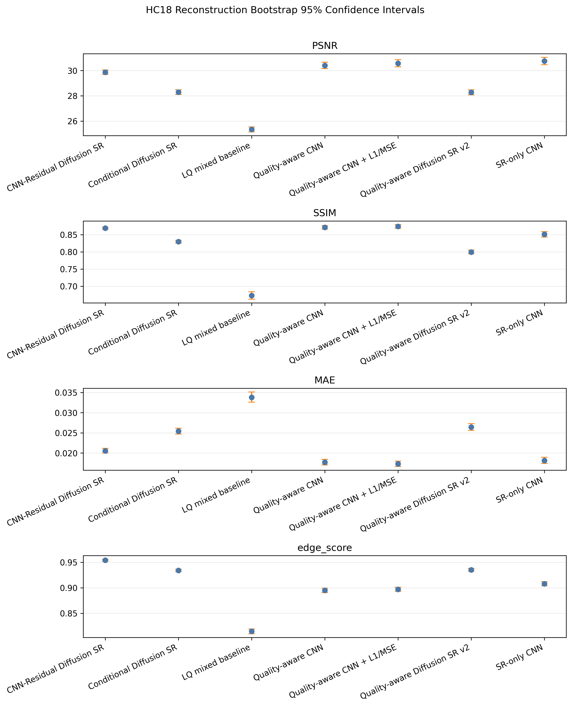
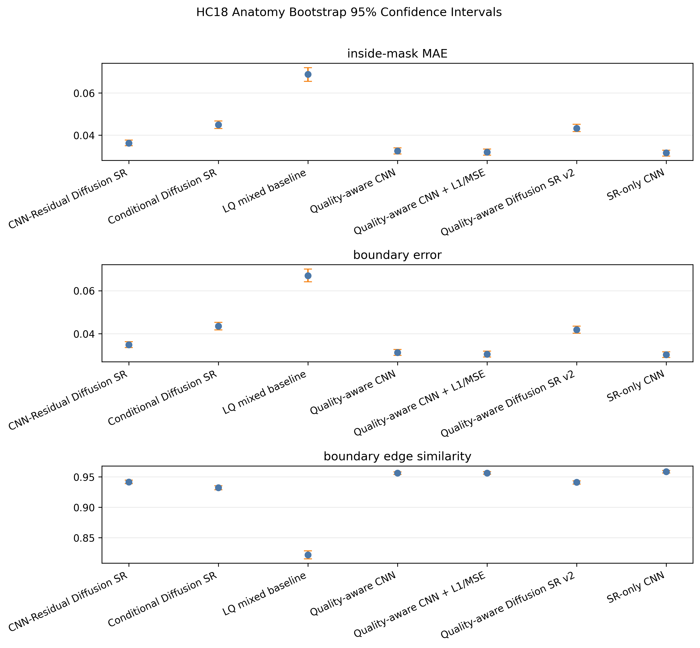
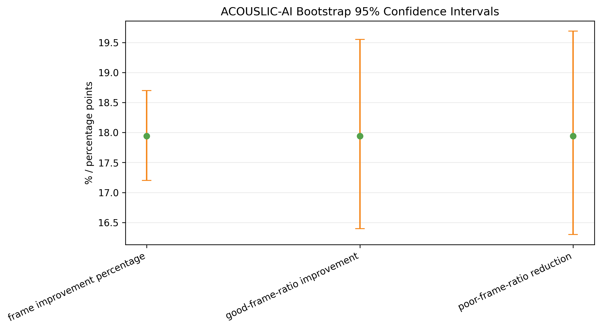

# Appendix: Proxy Acquisition-Aware Fetal Ultrasound Enhancement Report

This appendix collects supporting details for the main conference-style report. It intentionally excludes failed or outdated weak Dice/IoU results and treats debug-only artifacts as development evidence rather than main results.

## A. Improved HC18 U-Net Segmentation Details

The improved U-Net analysis uses HC18 fetal-head masks with ellipse-fitted filled mask preprocessing. The segmentation metrics are supporting anatomy-preservation evidence and are not expert clinical validation.

### A.1 Mask Audit Summary

| Item | Value |
|---|---:|
| Readable masks checked | 999 |
| Suspicious masks | 10 |
| Suspicious mask fraction | 1.00% |
| Missing HR images | 0 |
| Missing masks | 0 |
| Selected preprocessing method | `F_ellipse_fitted_filled` |

Supporting files:

| Artifact | Path |
|---|---|
| Mask statistics CSV | `results/hc18_unet_improved_mask_statistics.csv` |
| Image-mask pairing grid | `results/hc18_unet_segmentation_figures/debug_image_mask_pairing.png` |

### A.2 U-Net Training Summary

| Item | Value |
|---|---|
| Architecture | U-Net with encoder channels 32, 64, 128, 256 and bottleneck 512 |
| Training epochs | 100 |
| Batch size | 8 |
| Optimizer | AdamW |
| Learning rate | 0.001 |
| Weight decay | 0.0001 |
| Loss | BCEWithLogitsLoss + DiceLoss |
| Scheduler | ReduceLROnPlateau |
| Gradient clipping | Enabled |
| Best validation Dice | 0.8776 |
| Best validation IoU | 0.8130 |
| Best epoch | 26 |
| HR test Dice | 0.8897 |
| Best threshold | 0.50 |

### A.3 Threshold Tuning Table

| Threshold | Validation Dice | Validation IoU |
|---:|---:|---:|
| 0.20 | 0.8745 | 0.8071 |
| 0.25 | 0.8758 | 0.8094 |
| 0.30 | 0.8766 | 0.8109 |
| 0.35 | 0.8771 | 0.8119 |
| 0.40 | 0.8774 | 0.8125 |
| 0.45 | 0.8775 | 0.8128 |
| 0.50 | **0.8776** | **0.8130** |
| 0.55 | 0.8774 | 0.8128 |
| 0.60 | 0.8772 | 0.8125 |
| 0.65 | 0.8766 | 0.8116 |
| 0.70 | 0.8758 | 0.8102 |

### A.4 U-Net Figures

| Figure | Path | Use |
|---|---|---|
| Training curve | `results/hc18_unet_segmentation_figures/improved_training_curve.png` | Appendix training diagnostics |
| Example segmentation outputs | `results/hc18_unet_segmentation_figures/improved_example_segmentation_outputs.png` | Qualitative segmentation examples |
| Measurement error comparison | `results/hc18_unet_segmentation_figures/improved_measurement_error_comparison.png` | Supporting measurement-error visualization |
| Dice/IoU comparison | `results/hc18_unet_segmentation_figures/improved_dice_iou_comparison.png` | Main report figure |
| Overfit sanity check | `results/hc18_unet_segmentation_figures/overfit_sanity_check.png` | Development sanity check |

Recommended appendix embeds:

## B. HC18 Reconstruction and Anatomy Supporting Artifacts

| Artifact | Path |
|---|---|
| Reconstruction summary CSV | `results/final_all_hc18_comparison_summary.csv` |
| Reconstruction per-image CSV | `results/final_all_hc18_comparison_per_image.csv` |
| Reconstruction table Markdown | `results/final_all_hc18_comparison_table.md` |
| Anatomy preservation summary CSV | `results/anatomy_preservation_all_models_summary.csv` |
| Anatomy preservation per-image CSV | `results/anatomy_preservation_all_models_per_image.csv` |
| Anatomy preservation table Markdown | `results/anatomy_preservation_all_models_table.md` |
| SR output folder | `results/sr_outputs/` |
| Model checkpoints | `results/models/` |

Supporting HC18 figures:

| Figure | Path |
|---|---|
| PSNR comparison | `results/report_assets/figure_psnr_comparison.png` |
| SSIM comparison | `results/report_assets/figure_ssim_comparison.png` |
| MAE comparison | `results/report_assets/figure_mae_comparison.png` |
| Inside-mask MAE | `results/report_assets/figure_anatomy_mae_inside_mask.png` |
| Boundary error | `results/report_assets/figure_boundary_error.png` |
| Final visual comparison folder | `results/final_all_visual_comparison/` |

## C. ACOUSLIC-AI Proxy Quality and Feedback Artifacts

| Artifact | Path |
|---|---|
| Frame manifest | `data/processed/ACOUSLIC_AI/acouslic_frame_manifest.csv` |
| Proxy quality manifest | `data/processed/ACOUSLIC_AI/acouslic_proxy_quality_manifest.csv` |
| Sweep quality summary | `data/processed/ACOUSLIC_AI/acouslic_sweep_quality_summary.csv` |
| Proxy quality summary | `results/acouslic_ai/acouslic_proxy_quality_summary.md` |
| Feedback report | `results/acouslic_ai/feedback_report/acouslic_feedback_report.md` |
| Adaptive enhancement summary | `results/acouslic_ai/adaptive_feedback_enhancement_summary.csv` |
| Learned adaptive enhancement summary | `results/acouslic_ai/learned_adaptive_enhancement_summary.csv` |
| Sweep feedback reassessment summary | `results/acouslic_ai/adaptive_sweep_feedback_change_summary.csv` |

Supporting ACOUSLIC-AI figures:

| Figure | Path |
|---|---|
| Frame quality distribution | `results/acouslic_ai/feedback_report/frame_quality_distribution.png` |
| Sweep feedback distribution | `results/acouslic_ai/feedback_report/sweep_feedback_distribution.png` |
| Proxy-quality embedding confusion matrix | `results/acouslic_ai/proxy_quality_embedding_confusion_matrix.png` |
| Adaptive feedback enhancement figures | `results/acouslic_ai/adaptive_feedback_enhancement_figures/` |
| Adaptive sweep feedback change figures | `results/acouslic_ai/adaptive_sweep_feedback_change_figures/` |

## D. Bootstrap Confidence Intervals

Bootstrap confidence interval artifacts are available as supporting uncertainty analysis.

| Artifact | Path |
|---|---|
| Bootstrap CI CSV | `results/bootstrap_confidence_intervals.csv` |
| Bootstrap CI Markdown | `results/bootstrap_confidence_intervals.md` |
| HC18 reconstruction CI figure | `results/bootstrap_ci_figures/hc18_reconstruction_bootstrap_ci.png` |
| HC18 anatomy CI figure | `results/bootstrap_ci_figures/hc18_anatomy_bootstrap_ci.png` |
| ACOUSLIC-AI CI figure | `results/bootstrap_ci_figures/acouslic_ai_bootstrap_ci.png` |

Recommended appendix embeds:

## E. Proxy Label Manual Review Materials

Manual review materials are available to support inspection of proxy labels. These are not expert clinical annotations.

| Artifact | Path |
|---|---|
| Manual review CSV | `results/acouslic_ai/manual_review/proxy_label_manual_review.csv` |
| Good-frame contact sheet | `results/acouslic_ai/manual_review/contact_sheets/good_frame_contact_sheet.png` |
| Blurry-frame contact sheet | `results/acouslic_ai/manual_review/contact_sheets/blurry_frame_contact_sheet.png` |
| Low-contrast-frame contact sheet | `results/acouslic_ai/manual_review/contact_sheets/low_contrast_frame_contact_sheet.png` |
| Noisy-frame contact sheet | `results/acouslic_ai/manual_review/contact_sheets/noisy_frame_contact_sheet.png` |
| Poor-frame contact sheet | `results/acouslic_ai/manual_review/contact_sheets/poor_frame_contact_sheet.png` |

## F. Debug Artifacts

Debug artifacts are kept for reproducibility and development traceability but should not be used as main paper results.

| Artifact | Path | Suggested use |
|---|---|---|
| Emergency U-Net debug folder | `results/hc18_unet_debug/` | Development-only sanity checks |
| Archived unreliable Dice/IoU folder | `results/archived_unreliable_dice_iou/` | Do not report as final result |

The main report should use only the improved U-Net metrics from `results/hc18_unet_improved_metrics_table.md`.

